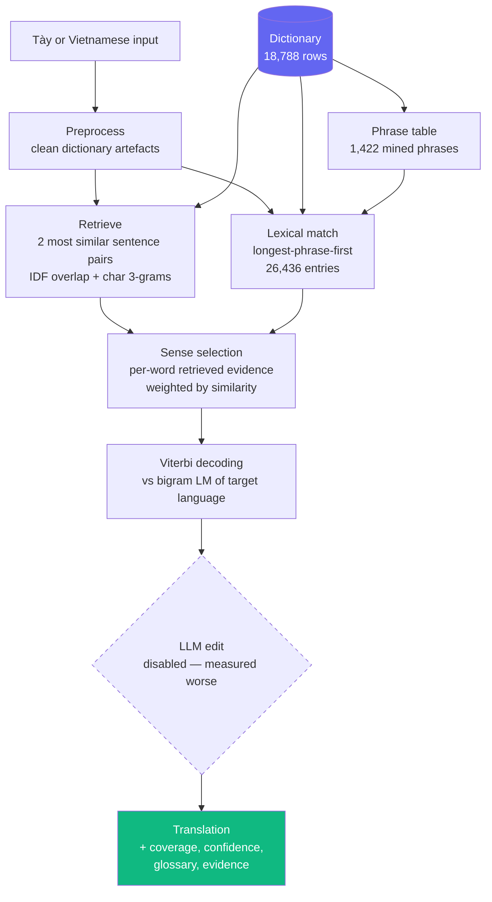

# Tày ↔ Vietnamese Translator — Technical Overview

Dictionary-grounded statistical machine translation for a low-resource language,
with a held-out evaluation methodology.

For a non-technical description, see [OVERVIEW.md](OVERVIEW.md). For runtime
detail and full benchmark tables, see [code/README.md](code/README.md).

---

## 1. Problem setting

**Tày** is a Tai-Kadai language with ~1.8 million speakers in northern Vietnam.
It has no MT support, no Whisper language code, and no meaningful pretrained
model coverage. There is no parallel corpus.

The only substantial resource is one digitised Vietnamese–Tày–Nùng dictionary:
18,788 rows, from which this project derives **26,436 lexical index entries** and
**14,179 aligned sentence pairs**. Everything the system knows comes from that
file.

Two structural difficulties:

1. **Direction mismatch.** The dictionary is organised Vietnamese→Tày. Inverting
   it for Tày→Vietnamese makes almost every word ambiguous: `mẻ` is the listed
   gloss of *mẹ, vợ, cái, gái, bà, nái, đẻ*.
2. **Examples are not discourse.** Dictionary examples show words in isolated
   idiomatic usage, not in the surrounding context that disambiguates them.

---

## 2. Architecture



Four layers matter, in order of contribution:

| Layer | Module | What it fixes |
|---|---|---|
| Lexical index | `excel_glossary.py` | Recovers word-level glosses the original parser discarded |
| Phrase table | `phrases.py` | Non-decomposable compounds (`rườn lảng` = "nhà cửa") |
| Sense selection | `excel_glossary.py` + `retriever.py` | Which of many meanings applies here |
| Sequence decoding | `lm.py` | Makes choices interact instead of being independent |

Both translation directions share this pipeline; the index, retriever and
language model are parameterised by direction rather than duplicated.

---

## 3. Results

500 held-out sentences, removed from every learned component before scoring.

**Tày → Việt** (inverted, harder direction)

| Stage | chrF | token-F1 | Exact |
|---|---|---|---|
| Original code | 0.104 | 0.077 | 0.0% |
| Repaired lexical layer | 0.369 | 0.479 | 10.8% |
| + retrieval-based sense selection | 0.386 | 0.486 | 12.4% |
| + Viterbi decoding | 0.400 | 0.508 | 13.0% |
| + mined phrase table | 0.427 | 0.532 | 14.4% |
| **+ multi-reference scoring** | **0.441** | **0.544** | **16.2%** |

**Việt → Tày** (native dictionary direction)

| Stage | chrF | token-F1 | Exact |
|---|---|---|---|
| **Lookup + Viterbi + mined phrases** | **0.471** | **0.579** | **18.2%** |

Token coverage on unseen input: **99.9%**. Published low-resource MT at this data
scale typically reports chrF 0.30–0.50.

**Metrics.** chrF (character n-gram F-score) is the primary metric, since
word-level metrics like BLEU are unstable on short sentences. Reported alongside
token-F1 and exact match.

---

## 4. Evaluation methodology

This is the part of the project worth reading closely.

An early harness reported **93.7% coverage**. The test set had been extracted
from the same spreadsheet the index was built from — **61.6% of test lines were
verbatim index keys** — and a further ~18% of that "coverage" was untranslated
Tày echoed back and counted as success. Real performance on unseen input was
**chrF 0.104**.

The root cause was three lines in the parser discarding the field that held each
entry's word-level gloss. The runtime index contained **zero single-word
entries**: it could reproduce memorised example sentences and translate nothing
else.

`eval_translation.py` now holds out test sentences from **every** component that
learns from the corpus:

| Component | Learns | Held out |
|---|---|---|
| Lexical index | phrase entries | ✅ both tone-preserved and tone-stripped layers |
| Retriever | example pairs | ✅ including near-duplicates |
| Bigram LM | target-side n-grams | ✅ |
| Alignment model | P(target \| source) | ✅ |
| Phrase table | aligned span pairs | ✅ |

**The same leakage recurred twice more and was caught both times.** Adding the
language model appeared to lift chrF 0.395 → 0.548; it had been trained on the
held-out targets and Viterbi was reconstructing memorised answers. Later,
multi-reference scoring revealed that alternate Vietnamese renderings of a
held-out sentence were surviving in training, which had inflated Việt→Tày by
~0.010.

---

## 5. Findings

Nine measured findings, most contradicting the intuition that motivated them.

### 5.1 Local LLMs lose to deterministic lookup

Two models × four configurations, same seed (n=80):

| Arm | chrF |
|---|---|
| **Lookup + context** | **0.393** |
| + `gemma3:4b` / with retrieval | 0.366 / 0.361 |
| + `qwen2.5:7b-instruct` / with retrieval | 0.371 / **0.375** |

Scaling 4B→7B bought ~0.014 chrF against a ~0.018 deficit. The 7B ran fully
GPU-resident (4.9 of 8 GB VRAM), so this is not a resource artefact. Notably
retrieval *hurts* the 4B model but *helps* the 7B — 4B is too weak to exploit
few-shot examples. Gated behind `USE_LLM=1`, off by default.

### 5.2 Nearly all remaining error is sense selection

Failure modes over 400 held-out sentences:

| Mode | Share |
|---|---|
| **Wrong sense** | **49.2%** |
| Mostly wrong | 35.8% |
| Exactly right | 14.0% |
| Right words, wrong order | 0.8% |
| Word missing from dictionary | 0.2% |

Word order and coverage are effectively solved. This corrects an assumption held
earlier in the project, where word order was treated as a core limitation.

### 5.3 Six disambiguation signals, all saturating

| Signal | Verdict |
|---|---|
| Corpus-frequency ranking | Baseline |
| Retrieved context, per-word | **+0.017 chrF** — the one that worked |
| Retrieved context, pooled across sentences | **−0.001 vs no context** — actively harmful |
| Bigram LM + Viterbi | +0.005 on top of context (heavy weight needed without it) |
| IBM Model 1 alignment | 0 on top of context; **+0.017 token-F1 without it** |
| Local LLM (4B, 7B) | Negative |

The pattern is consistent: each signal works in isolation and is redundant with
retrieved context. The information needed to disambiguate is not in the data.

### 5.4 A learned model can be correct and still not help

`align.py` trains IBM Model 1 with Expectation-Maximization — unsupervised, ~5 s
on CPU, both directions. What it learns is clearly better than the hand-written
frequency rule:

| Tày | learned by EM | hand-tuned rule |
|---|---|---|
| `mẻ` | **mẹ** (0.71) | "cái" ✗ |
| `slương` | **thương** (0.25) | "bộ" ✗ |
| `pỏ` | **bố** (0.37), cha (0.32) | "ba" |

It still adds nothing end-to-end, because retrieved context already fixes those
cases. It found its real use elsewhere: **mining the phrase table**. Wrong tool
for ranking senses, right tool for finding phrases.

### 5.5 Phrase mining was the largest gain after the initial repair

`phrases.py` applies standard SMT phrase extraction: symmetrise the bidirectional
IBM Model 1 alignments with **grow-diag-final**, then keep every contiguous span
pair consistent with the alignment and seen at least twice. 1,422 phrases, and
they are genuine non-decomposable compounds:

| Tày | Vietnamese | count |
|---|---|---|
| `kin phuối` | ăn nói | 63 |
| `slửa khóa` | quần áo | 60 |
| `rườn lảng` | nhà cửa | 31 |

chrF 0.400 → 0.427. Mined phrases score 18, below the 20 given to verbatim
dictionary examples: **inferred evidence loses ties to attested evidence.**

### 5.6 Fewer retrieved examples beat more

| K | 1 | **2** | 3 | 5 | 8 | 20 |
|---|---|---|---|---|---|---|
| chrF | 0.390 | **0.399** | 0.393 | 0.387 | 0.378 | 0.376 |

Retrieved context also *hurts* the Việt→Tày direction (0.481 → 0.463), where
lookup is already unambiguous — so the API skips retrieval there.

### 5.7 Calibration had to be validated before it could be believed

The claim "the system knows when it doesn't know" failed its first check.
Confidence separated `high` from `medium` by whether any multi-word phrase
matched — a signal correlating **−0.010** with chrF. The buckets were
indistinguishable (0.405 vs 0.403).

Feature correlations with chrF:

| feature | correlation |
|---|---|
| ambiguous-span fraction | **−0.234** |
| weak-match fraction | −0.155 |
| coverage | +0.027 |
| phrase fraction *(the signal in use)* | −0.010 |

Rebuilt as `risk = 0.6 × ambiguity + 0.4 × weak_matches`:

| | old | **new** |
|---|---|---|
| high | 0.405 | **0.632** |
| medium | 0.403 | 0.453 |
| low | 0.307 | 0.289 |
| gap | +0.098 | **+0.343** |

Enforced by a test. `calibration_report.py` regenerates
[`calibration.svg`](code/calibration.svg).

Coverage turns out to be nearly useless as a discriminator: 497 of 500 held-out
sentences report 100% coverage, including badly translated ones. It answers "were
the words found", not "were the right meanings chosen".

### 5.8 The system must refuse to sound confident on under-specified input

Three guards. The subtle one: `khoi pay thieo`, typed without diacritics, matches
real but *different* Tày words **exactly**, producing "hòa mèm thêu" at 100%
coverage. No source-level heuristic detects this — only noticing that the input
itself is under-specified.

| Input | Output | Coverage | Confidence |
|---|---|---|---|
| `ỏ mẻ mà dá` | a mẹ đã về ✓ | 1.00 | high |
| `kin khẩu` | ăn cơm ✓ | 1.00 | high |
| `ruơn` (tone dropped) | nhà ✓ | 1.00 | low |
| `khoi pay thieo` (no tones) | hòa mèm thêu ✗ | 1.00 | **low** + warning |

### 5.9 Fuzzy matching fixes coverage, not accuracy

On deliberately corrupted input, coverage rises 0.886 → 0.973 and unknowns drop
0.37 → 0.09 per sentence, while chrF drifts slightly *down*. Kept on because a
flagged guess helps a learner more than `[unknown]`, but not claimed as an
accuracy improvement.

---

## 6. Testing

19 tests, asserting behaviour rather than types:

- Known phrases translate correctly
- The index still contains single-word entries — a guard on the original bug
- Coverage accounting stays honest (passthrough never inflates it)
- Under-specified input is forced to low confidence
- Both learned components can be trained with held-out sentences excluded
- **Regression floor** on held-out chrF, token-F1 and coverage
- **Calibration separation** — confidence labels must track real quality

```bash
cd code && python -m pytest tests/ -v
```

---

## 7. Limitations

- **Fine-grained sense disambiguation is the ceiling** and is not solvable from
  this data.
- **Idioms defeat word-by-word assembly** where no phrase entry exists.
- **Speech input is a workaround** — Whisper runs as Vietnamese with a Tày
  orthography prompt.
- **No Tày text-to-speech** exists.
- **One dictionary**, whose examples are short and idiomatic rather than natural
  conversation.

---

## 8. What would actually help

Not more scoring signals — six have been measured and the returns have flattened.
`reference/ABC.txt`, which looked like a second dictionary, turned out to overlap
the existing one by 99.7% (36 new headwords out of 12,752).

Two things remain worth doing:

1. **A frontier API model.** Local models up to 7B are measured as worse than
   lookup. An API model would settle whether the ceiling is the data or the
   generator — one experiment, unambiguous answer.
2. **More Tày text in context.** The measured bottleneck is meaning selection,
   and dictionary examples show words in isolation. This is language
   documentation, not engineering.

---

## 9. Code map

| Path | Role |
|---|---|
| `code/main.py` | FastAPI app, pipeline orchestration, confidence calibration |
| `code/translation_api/excel_glossary.py` | Index construction, matching, sense selection, Viterbi |
| `code/translation_api/retriever.py` | Similar-sentence retrieval |
| `code/translation_api/lm.py` | Per-side bigram language models |
| `code/translation_api/align.py` | IBM Model 1, both directions, EM |
| `code/translation_api/phrases.py` | Phrase extraction from symmetrised alignments |
| `code/translation_api/stt.py` | Whisper speech-to-text |
| `code/templates/tay_chat.html` | Web interface |
| `code/eval_translation.py` | Held-out evaluation harness |
| `code/calibration_report.py` | Confidence validation + figure |
